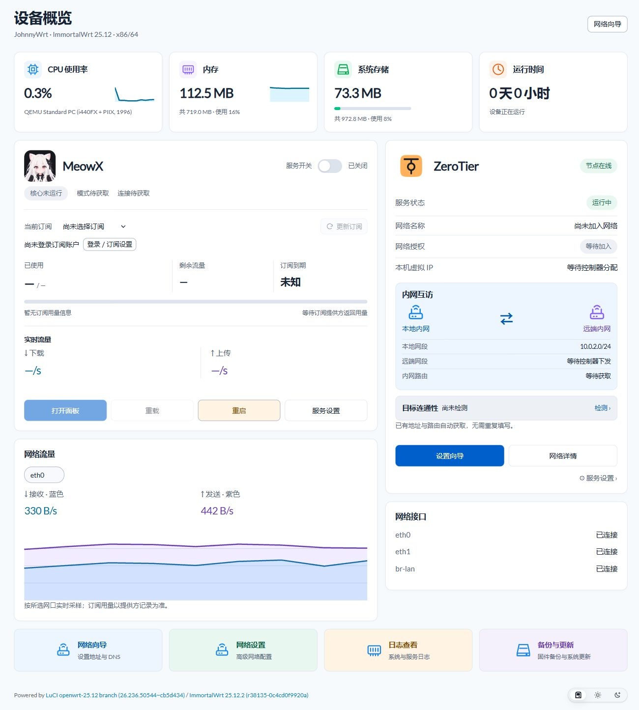
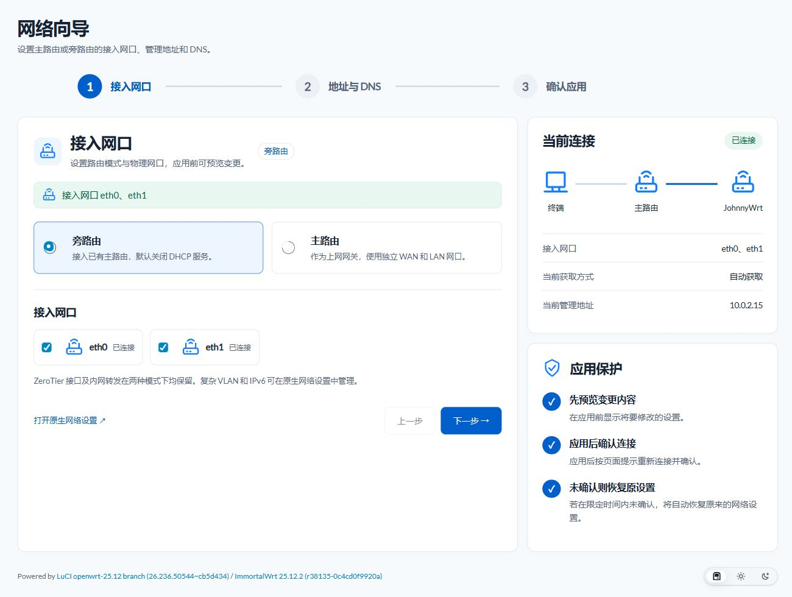
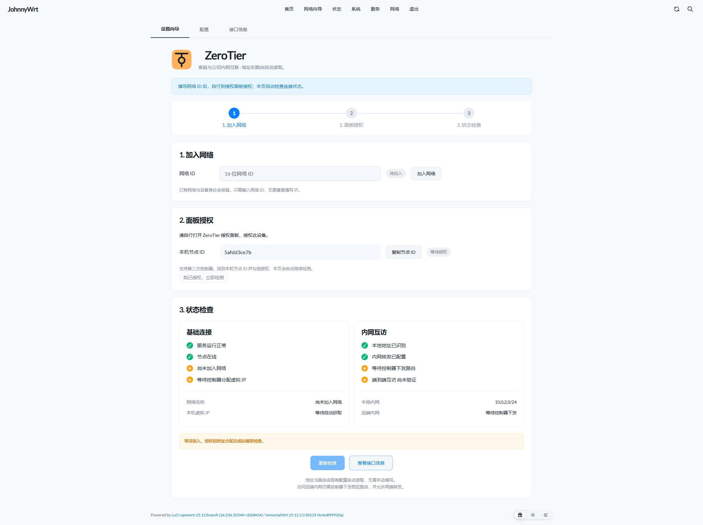

# JohnnyWrt

基于 **ImmortalWrt 稳定版** 的 x86/64 固件，提供独立首页、主／旁路由网络向导、MeowX 与 ZeroTier。使用 GitHub Actions 构建，安装包与在线更新统一发布到本仓库。

[下载固件](https://github.com/Johnnnypro/JohnnyWrt/releases) · [构建记录](https://github.com/Johnnnypro/JohnnyWrt/actions) · [维护说明](MAINTENANCE.md)

## 页面效果

以下为一次性测试机中的实际 LuCI 页面，使用 Aurora 主题。没有导入私人账户、订阅或组网资料；未配置的数据会显示待获取，不会伪造在线状态或用量。

### 独立首页

- 查看 CPU、内存、磁盘、运行时间、网口状态与实时流量。
- MeowX 使用原插件的账户资料、头像和订阅用量；服务提供开启、关闭、重载、重启及面板入口。
- 订阅已用、剩余与到期信息以服务端提供的数据为准，未提供的数据明确显示不可用。
- ZeroTier 分别显示服务运行、节点在线、网络授权、分配地址和内网转发信息；在线不等于两地内网已完全连通。

### 主／旁路由网络向导

三步完成：选择模式和物理网口 → 地址与 DNS → 预览并应用。

| 模式 | 设置方式 |
| --- | --- |
| 旁路由 | 管理地址自动获取或手动填写；默认关闭本机 DHCP 服务 |
| 主路由 | 独立 WAN／LAN 网口；WAN 支持 DHCP、固定地址与 PPPoE，LAN 可开启 DHCP |

应用使用 LuCI 原生连接确认与超时回滚。已有 VLAN、多接口等复杂配置请使用原生网络页面。两种模式均保留 ZeroTier 接口与内网转发，不依赖 iStore 或 QuickStart。

### ZeroTier 设置向导

在“服务 → ZeroTier → 设置向导”填写网络 ID，然后自行打开授权面板授权。页面自动检查授权、节点和地址，兼容第三方控制器；控制器开启地址分配后，无需在此重复填写虚拟 IP。

两地内网互访仍取决于控制器托管路由、两地不同的 LAN 网段、客户端网关与防火墙。本机提供 LAN 双向转发和限于直连 IPv4 LAN 的回包 NAT；向导显示检查结果，不把“已加入网络”当作完整连通证明。原生配置、接口信息页面保留。

## 下载与安装

当前目标为 x86/64、EFI/GPT、SquashFS，32 MiB 引导分区与 1024 MiB 根分区。以发布页列出的实际版本与软件包清单为准。

| 文件 | 用途 |
| --- | --- |
| `Johnnywrt-x86_64-squashfs-combined-efi.img.gz` | LuCI 保留配置升级，或解压后写入新磁盘 |
| `Johnnywrt-x86_64.iso` | 全新安装器，启动后执行 `ddd` 选择目标磁盘 |
| `SHA256SUMS` / `.manifest` / `firmware.json` | 校验、实际软件版本与更新元数据 |

**全新安装会清空所选磁盘。不要把 ISO 上传到固件升级页面。** 新装建议使用 UEFI；现有 BIOS 启动设备升级时保持原启动方式，不同时更改磁盘布局。未提供 Secure Boot 签名保证。

首次启动默认是旁路由：物理网口加入 LAN，通过上级 DHCP 获取管理地址，本机 DHCP 服务关闭。首次接入只连接一个网口到现有局域网，在上级租约中查找 `JohnnyWrt`。用户名 `root`，新装初始无密码，请先设置密码。

SSH 或本地控制台输入 `quickstart`，可查看当前地址，修改管理 IPv4、掩码、网关和 DNS，或切回 DHCP。输入后会展示预览，确认才保存；应用会断开当前连接，请按提示使用新地址重连。本控制台菜单确认后不自动回滚，改错地址可在本地控制台修正。它使用原生 UCI，不安装旧 QuickStart 服务；复杂接口或多个 LAN DHCP 配置应使用网页高级网络设置。

“系统 → 主题设置”保留 Aurora、Argon、Bootstrap 等已安装主题选择，并提供跟随系统、浅色、深色。选择 Argon 后可打开详细设置弹窗。已移除自定义 CSS 编辑与加载入口。

## 保留配置与在线更新

先下载配置备份，再进入“系统 → 备份与更新 → 更新固件”。上传 `.img.gz`，保留配置；校验失败时不要强制刷写。网络、MeowX 订阅与 ZeroTier 身份应保留，自行安装的软件包需要检查或重装。

**从旧账号的 JohnnyWrt 或 ImmortalWrt-ImageBuilder 仓库迁移：先手动安装本仓库固件一次，以后在线更新使用 `Johnnnypro/JohnnyWrt`。** 已安装的旧固件不会自动更改其更新来源。

在线更新依次执行检查、下载和校验，只有单独确认后才升级。固定使用本仓库，核对 SHA256、25.12 系列版本、分区布局和系统校验；不会无人值守刷机。

## 构建与验证

在 Actions 运行 `Build 25.12.x ISO x86-64`，默认稳定版、1G、Docker=no。主分支为 `main`，不再依赖旧仓库的工作流。旧仓库仅提供兼容性测试所需的固定版本的上一版正式固件，不再作为更新来源。

发布工作流要求页面逻辑与脚本检查、包清单检查、UEFI 启动、网络应用／回滚、真实 SSH 登录、旧到新和新到新保留配置升级，以及 ISO 内嵌固件一致性检查全部通过。具体执行结果请看对应 Actions；实机网卡、运营商拨号及私人订阅／两地网络需在实际环境检查。

修改或重跑失败构建前，请先读 [AGENTS.md](AGENTS.md) 与 [MAINTENANCE.md](MAINTENANCE.md)。仓库不包含个人订阅、站点网址、密码、ZeroTier 网络 ID 或身份密钥。

## 来源与许可

本项目是个人维护的定制固件，并非 ImmortalWrt 官方发布。构建脚本源自 [wukongdaily/ImmortalWrt-ImageBuilder](https://github.com/wukongdaily/ImmortalWrt-ImageBuilder)，使用 ImmortalWrt ImageBuilder；安装器源自 wukongdaily/img-installer。界面集成 Aurora、MeowX（基于 Nikki）、ZeroTier 与 zashboard，保留各组件原有许可和署名。

仓库脚本遵循 [GPL-3.0](LICENSE)；第三方软件与品牌标志归各自作者所有。
